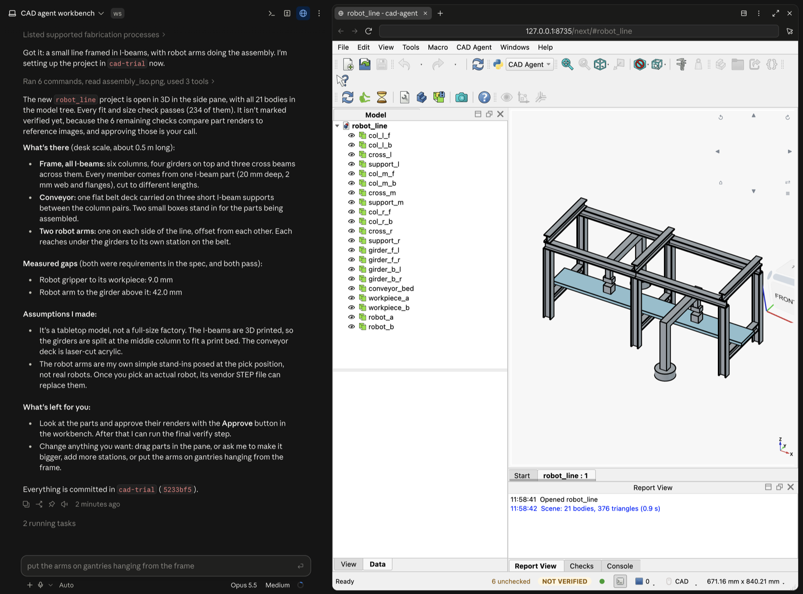
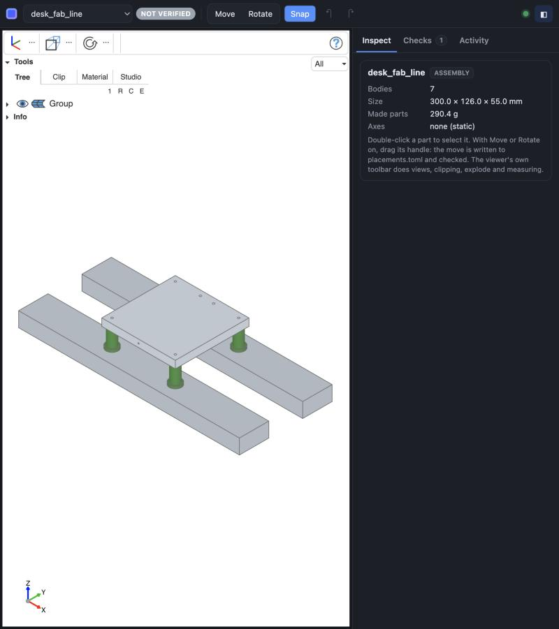
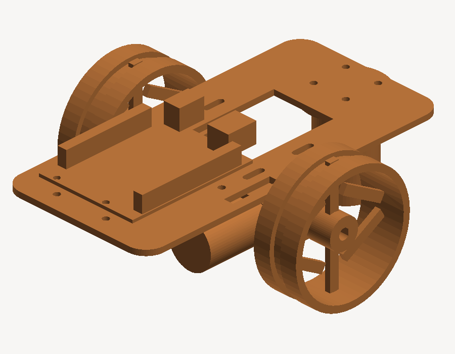
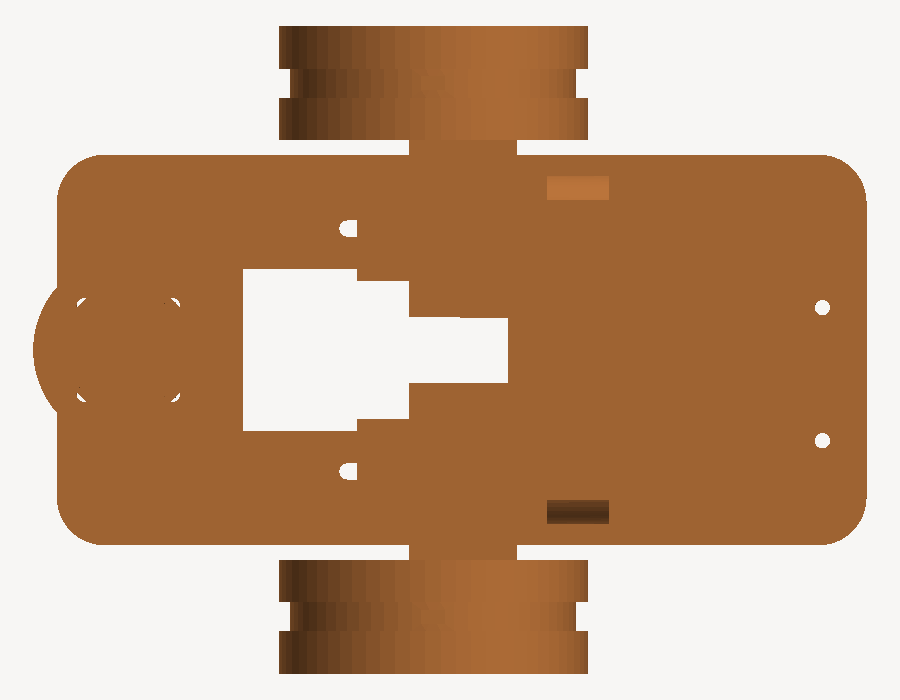

# cad-agent

AI agents that design mechanical parts and machines. You describe a part, an assembly or a machine; the agent writes it as code, checks that the parts fit, and shows you the result in a live 3D workbench where you can move parts yourself. A design is only marked done when every check passes.

## Demo

Ask Claude Code for a design; it builds it, checks it, and opens it in the workbench next to the chat. Here: a small robot assembly line in I-beams, with 21 parts and 234 fit and size checks passing.



More designs: the workbench inspector, and an Arduino car.




| | |
|---|---|
|  |  |

## What it does

- **Parts and assemblies as code.** Each part is a Python module (build123d). Gates check fit, motion, wall thickness, what the process can make, and where every bought part's numbers came from.
- **A spec as acceptance tests.** `spec.toml` states what the design must do: sizes, clearances, keep-outs, bolt holes that line up, mass budgets, hot zones (everything near a heater is rated for it), beam deflection, axes, how many bodies, what goes to a shop. What a rule can't measure says UNCHECKED, and UNCHECKED is not a pass.
- **A library of real parts.** MGN rails and carriages, 2020/2040/4040 extrusions, NEMA 8 and 17 motors, ISO fasteners, each with its source, mass and hash.
- **Machines.** A machine is projects linked as sub-assemblies (a gantry, a head), with named poses. Each one stays a full project, and the machine is done only when every one is.
- **Files for a shop.** STEP, DXF for laser parts, 3MF and STL for printed ones, dimensioned drawings of plates and a bill of materials, written only for a design that is done, with a manifest of hashes.

## Install

In Claude Code:

```
/plugin marketplace add El-Guapo2024/cad-agent
/plugin install cad-agent@cad-agent
```

Then ask it to design something ("design a bracket for a NEMA 17 motor"), and open the workbench with `/cad-agent:workbench`.

## How to use

1. **Open a session in your project folder.** Make it a git repo: only committed work counts as verified. The first session after installing sets up the CAD kernel, which takes a few minutes.
2. **Ask for a design** in plain words, like "a small assembly line framed in I-beams, with two robot arms". Claude writes each part as code in `cad-projects/<name>/`, checks that everything fits, and commits it.
3. **Look at it** with `/cad-agent:workbench`. The 3D workbench opens next to the chat, with every part in the model tree.
4. **Change it** by asking ("put the arms on gantries hanging from the frame") or by dragging parts in the workbench. Every change gets checked again.
5. **Approve the renders.** Some checks compare each part's picture with an approved one, and approving is your call: **CAD Agent > Approve Renders…** in the workbench. Then Claude runs the final verify, and the design is marked done.

The status bar shows what's left, like "6 unchecked · NOT VERIFIED" before the renders are approved. Ask "review the design" for a second opinion on things no check covers, such as assembly order and tool access.

## Commands

You mostly ask Claude and it runs these; they work from a shell too (`cad --help` lists them all). The exit code is the verdict: 0 pass, 1 FAIL, 2 UNCHECKED, 3 bad arguments, 4 crash.

```
cad init | check | verify | done              the design loop: a design is done only when verify passed on committed work
cad lib ls | info | use | add | fetch | check  the part library
cad export <project> <part> --format step|stl|3mf|dxf
cad bom <project>                              the bill of materials (CSV and JSON)
cad shop <project> [--draft | --check]         the shop files, for a design that is done
cad drawing <project> <part>                   a dimensioned drawing of a machined or laser-cut plate (DXF, SVG, PDF)
```

## The library

Vendor STEP files never go in this repo. They live in a folder of yours, `~/.cad-agent/library` or wherever `CAD_LIBRARY` points (a private repo works). `cad lib fetch` downloads a file only where its licence allows it; for any other, download it by hand and run `cad lib add`. `cad lib use` copies what a design needs into its `bought/` folder with its source, mass and hash, so verifying a design never reads the library.

The ISO fasteners come from [bd_warehouse](https://github.com/gumyr/bd_warehouse). The plugin's installer adds it.
In a checkout of your own it is an optional extra:

```
pip install '.[fasteners]'
```

If it is missing, `cad lib use` says the exact command for the Python that runs `cad`.

## License

MIT ([LICENSE](LICENSE)), except the workbench UI. [ui/](ui/) and its build in `cad_agent/workbench/next/` are ported from [FreeCAD](https://github.com/FreeCAD/FreeCAD) and use its icons, so like FreeCAD they're LGPL-2.1-or-later ([ui/LICENSE](ui/LICENSE); [ui/NOTICE](ui/NOTICE) names the FreeCAD files and authors).

Three files outside `ui/` derive from FreeCAD and keep its licence in their headers: `geom.py` (`mass_properties`, LGPL-2.1-or-later), `dxf.py` (the static sections of the DXF it writes, BSD-3-Clause) and `appcache.py` (LGPL-2.0-or-later). The cards in `materials.py` are FreeCAD's (CC-BY-3.0 for five of them, credited wherever their values are printed). [NOTICE](NOTICE) says which part is under which licence and what third-party code the repo ships (React, three.js, three-cad-viewer and the rest of the UI bundle, FreeCAD's icons); [THIRD_PARTY_LICENSES](THIRD_PARTY_LICENSES) has the licence texts. The wheel carries all of them.

## Links

- GitHub: https://github.com/El-Guapo2024/cad-agent
- Full docs: [docs/DETAILS.md](docs/DETAILS.md)
